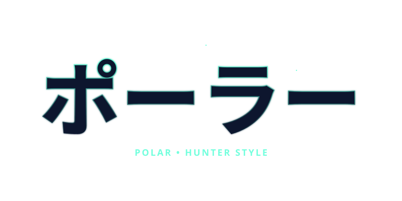

<!-- =============================== -->
<!-- README de Mauro "Polar" Alvan -->
<!-- =============================== -->

<h1 align="center">Mauro Alvan | <em>Polar</em></h1>

<a href="#-sobre-mí">Sobre mí</a> · <a href="#-stack-y-herramientas">Stack</a> · <a href="#-proyectos">Proyectos</a> · <a href="#-certificaciones-y-cursos">Certificaciones</a> · <a href="#-actividad">Actividad</a>

---

<blockquote>
<b>🧭 Estudiante de Ingeniería de Sistemas e Informática en la UTP (8.º ciclo), Lima, Perú.</b> 
Me formo en bases de datos, análisis y visualización de datos. 
Busco una práctica preprofesional en datos o sistemas de información, en el sector financiero o tecnológico.
</blockquote>

---

<table align="center" width="100%">
<tr>
<td width="50%" valign="top">

## 🧊 Sobre mí

- **Polar**: enfoque, resiliencia y calma.
- Me gusta ordenar procesos y convertir datos en decisiones.
- Antes de la carrera trabajé más de 3 años en operaciones de transporte; ahí aprendí a distinguir qué información sirve y cuál estorba.
- Me interesan la automatización, la ciberseguridad y la IA.
- 🎮 Gamer: Mortal Kombat, GTA.

</td>
<td width="50%" valign="top">

## 💻 Stack y herramientas

- **Bases de datos:** SQL Server, Oracle (PL/SQL), MySQL
- **Datos y BI:** Power BI con DAX, Excel con VBA
- **Lenguajes:** Java, Python
- **Otros:** Linux, Git, GitHub, Scrum

</td>
</tr>
</table>

## 🚀 Proyectos

| Proyecto | Qué es | Tecnologías |
|---|---|---|
| [**Metro Línea 1: gestión de turnos**](https://github.com/Malvan03/Malvan03-L1_SIS) | Aplicación web para asignar turnos y cambios de conductores, pensada para reducir errores humanos. | Java, JSP, SQL Server, HTML, CSS, JavaScript |
| **Proyecto BI: Sistema Metropolitano de Lima** | Modelo dimensional (hechos y dimensiones), scripts SQL de carga y dashboard con KPIs y medidas DAX. | SQL Server, Power BI, DAX |
| **SIGA: Sistema Integrado de Gestión de Asistencia** | Como Product Owner de un equipo Scrum de 5 personas, defino el alcance de un sistema web de asistencia para colegios: product backlog, matriz RACI y prototipos. | Scrum, UML |

> Más detalle de cada proyecto en mi [LinkedIn](https://www.linkedin.com/in/malvan/).

<b>📜 Certificaciones y cursos</b>

- SQL Server, Base de Datos 1 y 2 (UNI)
- Oracle SQL y PL/SQL (Skill, Estado Peruano)
- Programación con Java (Skill, Estado Peruano)
- Power BI, Básico e Intermedio (UNI)
- Python, Básico e Intermedio (UNI)
- Fundamentos de Linux (UNI)
- Excel con Macros (UNI)
- ISO 27001, ISO 31000, ITIL 4, Oracle y Java (UNI)
- Ethical Hacking y CyberSOC (UNI)

## 💡 Filosofía de trabajo

> **"La excelencia se logra sumando pequeños esfuerzos cada día."**

`#Innovación` `#Disciplina` `#AprendizajeConstante`

<h2 align="center">📊 Actividad</h2>

<i>"La excelencia no es un acto, sino un hábito." — Aristóteles</i>

